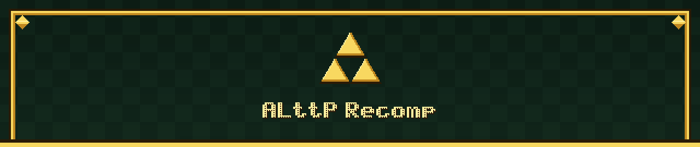
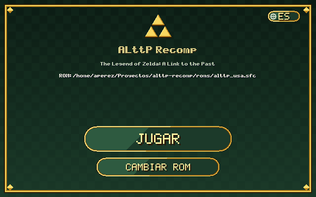
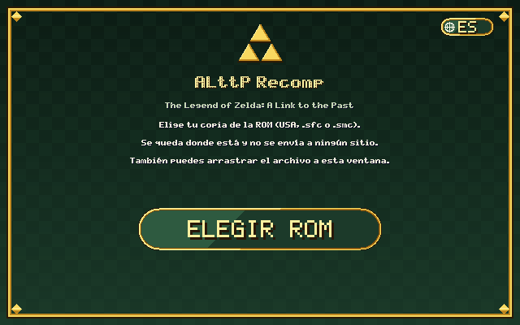
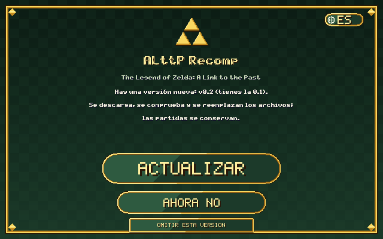
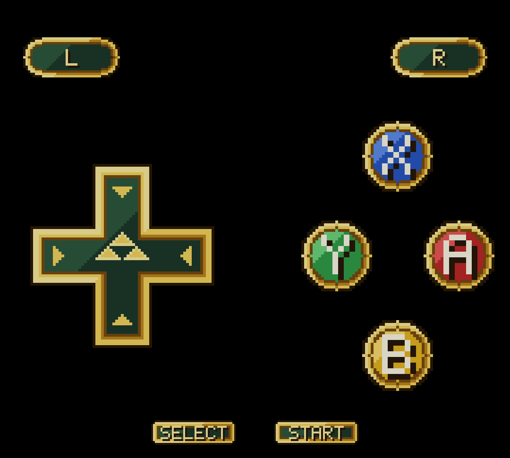

  

<h3 align="center">The Legend of Zelda: A Link to the Past, recompilado a código nativo</h3>

<a href="README.md">English</a> · <b>Español</b> · <a href="https://argoxdevs.github.io/alttp-recomp/?lang=es">Página de descargas</a>

  
  
  
  
  

No es un emulador: el programa del cartucho se **traduce a código nativo** (con el motor [`snes-recomp`](https://github.com/ArgoxDevs/snes-recomp)) y se compila en tu equipo a partir de **tu** copia del juego. El resultado arranca al instante, mantiene los 60 fotogramas por segundo incluso en un móvil de gama alta y permite mejoras que un emulador no da: pantalla ancha, español, estados guardados y rebobinado, y un puñado de ajustes de calidad de vida.

> **Aviso legal.** Este repositorio no contiene la ROM ni ningún recurso del juego (gráficos, sonido, texto, mapas), y no lo tendrá. Cada persona debe aportar su propia copia obtenida legalmente (USA, CRC32 `777AAC2F`). Nada derivado de ella se distribuye ni sale de tu equipo. Proyecto independiente y sin relación con Nintendo.

## Estado

- **Beta.** Las releases **0.16** y posteriores llevan el arreglo de la parada en las salas `0x01B`, `0x043` y `0x097` en Windows, Linux y Android (el generador deja 0 funciones sin traducir de 4 178). Si tienes la 0.13 o anterior, actualiza. Nadie ha terminado aún el juego con la recompilación: cuéntanos cualquier parada o fallo (las [preguntas frecuentes](docs/FAQ.es.md) explican el mensaje `UNSUPPORTED`). El [CHANGELOG](CHANGELOG.md) tiene los detalles.
- **Una partida completa aún no está demostrada.** La intro, la selección de partida, las primeras zonas y las 133 entradas de mazmorra cargan y funcionan, pero nadie ha terminado el juego con la recompilación. Hasta que eso cambie, trata cualquier versión como una beta. Lo que se va descubriendo está en [`docs/HALLAZGOS.md`](docs/HALLAZGOS.md).
- Si algo falla, [abre un issue](https://github.com/ArgoxDevs/alttp-recomp/issues/new/choose) con la versión, dónde pasó y qué hacías (sin adjuntar nunca la ROM, partidas ni capturas con gráficos del juego).

## Descargar y jugar

Lo más fácil es la **[página de descargas](https://argoxdevs.github.io/alttp-recomp/?lang=es)**: detecta tu sistema y te da el fichero correcto. También puedes tomar el paquete de la [última release](https://github.com/ArgoxDevs/alttp-recomp/releases/latest). **No hay que instalar nada ni usar la terminal.**

| | Windows | Linux | Android |
|---|---|---|---|
| **Fichero** | `alttp-recomp-…-win64.zip` | `alttp-recomp-…-linux-x86_64.tar.gz` | `ALttP-Recomp-….apk` |
| **1.** | Descomprime | Extrae | Descarga e instala (permite la fuente) |
| **2.** | Abre `alttp-recomp.exe` | Abre `alttp-recomp` | Abre la app |
| **3.** | **Elegir ROM** y **Jugar** | **Elegir ROM** y **Jugar** | Elige tu ROM y juega |
| **Requisitos** | Windows 10 o 11 | x86_64, glibc 2.34+ (Ubuntu 22.04, Debian 12 o posterior) | Android 10+ (arm64) |

  
  
  

El lanzador de Windows y Linux: elige tu ROM una vez y después solo pulsas <b>Jugar</b>. A la derecha, el aviso opcional de versión nueva. El globo de arriba a la derecha cambia el idioma (en Linux; en Windows sigue el del sistema).

La ROM se queda donde está: solo se recuerda su ruta, y en Android se copia a la carpeta privada de la app. La primera vez el juego se prepara en tu equipo (en Linux y Android, unos segundos); si algo falla, la ventana lo cuenta.

> Es normal que algún antivirus desconfíe de un programa sin firmar que compila código al arrancar. Todo ocurre en tu máquina.

## Características

- **Recompilación, no emulación.** Las 4 178 funciones de la ROM se traducen a C y se compilan; sin capa de emulación.
- **Pantalla ancha** sin basura: con `wide` el borde del mapa y el interior de salas y cuevas se tapan en negro en vez de repetir el otro lado del mapa.
- **Español completo.** Mensajes, selección de partida, registro de nombre y acciones del menú de pausa, con acentos, `ñ`, `¿` y `¡` dibujados al vuelo con la propia fuente del juego. [Cómo funciona →](docs/TRADUCCION.md)
- **Estados guardados y rebobinado.** **F5** guarda, **F7** carga, **F3**/**F4** cambian de ranura (hasta 9), **F6** abre un selector con las nueve ranuras (miniatura y fecha de cada una) y mantener **Retroceso** rebobina unos 10 segundos.
- **Mensajes más rápidos.** Mantén **R** (o `W` en el teclado) y el texto sale un carácter por fotograma.
- **Mejoras de calidad de vida opcionales** (saltar la intro con una tecla, cambio de objeto con L/R, espada que recoge objetos y rompe vasijas, hasta 9999 rupias…): [lista completa](#mejoras-de-calidad-de-vida).
- **Android de verdad.** Un APK con controles táctiles hechos para el juego: la cruceta con la Trifuerza (la dirección se lee por ángulo, así que un pulgar algo torcido no da dos direcciones a la vez), botones A/B/X/Y de gema, disposiciones vertical y horizontal y placas para los estados guardados (**SAVE**, **LOAD**, **SLOT** y **REWIND**). El **menú de opciones también se maneja con el dedo** (pestañas, filas, mitad izquierda o derecha de un valor) y la pantalla de inicio tiene el mismo aspecto que los lanzadores de escritorio, con un botón de idioma **EN / ES**.
- **Lanzadores para cada sistema.** Windows: una ventana donde eliges tu ROM una vez. Linux: un lanzador nativo autónomo (sin gcc; lleva su propio compilador) con el arte del juego y un botón de idioma **EN / ES**. Android: la pantalla de inicio de la app. En todos sale **Jugar** cuando ya hay ROM elegida.
- **Actualizaciones desde la propia app.** Windows y Linux: el lanzador avisa de una versión nueva y la instala tras comprobar su SHA-256 (**apagado por defecto**). Android: la app avisa, descarga el APK, comprueba su SHA-256 y se lo da al instalador de Android (**activo por defecto**, se apaga en la pantalla de inicio). [Detalles →](#actualizaciones)
- **Una página de descargas.** [argoxdevs.github.io/alttp-recomp](https://argoxdevs.github.io/alttp-recomp/?lang=es) elige el paquete de tu sistema y apunta siempre a la última release.
- **Probado.** Cada mejora, los estados guardados (una partida real guardada, estropeada y cargada de nuevo debe dejar la máquina idéntica bit a bit), los controles táctiles y el menú tienen pruebas automáticas que juegan con un guion.
- **Privacidad.** Sin telemetría ni cuentas. La única conexión posible es la comprobación de versión; tu ROM y tus partidas nunca salen de tu dispositivo.

  

Controles táctiles de la versión Android (arte propio).

## ¿Por qué no usar un emulador?

Un emulador es la mejor opción para jugar *cualquier* juego de SNES con la máxima fidelidad. Este proyecto hace otra cosa: convierte **este** juego en un programa nativo, y eso permite lo que un emulador no puede dar con la ROM original.

| | Emulador | ALttP Recomp |
|---|---|---|
| **Mejoras de jugabilidad** (cambio de objeto con L/R, espada que recoge objetos y rompe vasijas, más bombas, 9999 rupias…) | Exigen un hack de la ROM o un parche IPS | Se activan desde el menú F1 sobre tu ROM sin tocar, y cada una tiene prueba automática |
| **Español** | Parche aplicado a la ROM | Se sustituye en tiempo real, con acentos y `ñ` dibujados con la propia fuente del juego; el fichero se relee mientras juegas |
| **Pantalla ancha** | Casi siempre no, o con trucos por juego | Columnas extra reales, tapadas en negro donde no hay mapa |
| **Android** | Instalar un emulador y configurarlo | Un APK con controles táctiles hechos para el juego |
| **Extensible** | Hay que hacer ingeniería inversa y parchear | Se añade una mejora escribiendo C sobre el código ya traducido |
| **Fidelidad al hardware** | Muy alta (bsnes, por ejemplo) | Menor: la PPU no emula el entrelazado, lo que depende de ciclos exactos no se reproduce y el DSP no usa la tabla exacta |
| **Juegos** | Todos los de SNES | Solo este (USA, CRC32 `777AAC2F`) |

Lo que sí tiene este proyecto y también tienen los emuladores: estados guardados y rebobinado, filtros y scanlines, y reasignación de teclas y mandos desde el menú **F1**.

## Hoja de ruta

Cosas que los emuladores dan y este proyecto aún no. No están prometidas ni tienen fecha: son la dirección.

- **Shader de CRT** (máscara de fósforo, haz de scanline, curvatura y resplandor): en curso en el motor.
- **Más ajustes de imagen y mando**, con la comodidad de un emulador maduro.
- **Logros** (RetroAchievements) para el juego.
- **Juego en red** (netplay) o partida compartida.
- **Arreglos de bugs del juego original**, como opciones que se activan una a una (cada dirección se comprueba contra la ROM) y más mejoras de calidad de vida en C, a medida que se prueben.
- **Más idiomas.** El español está hecho; otro idioma sería una traducción redactada para el proyecto (texto propio, nunca extraído de una ROM), como `lang/es.txt`. [Cómo proponerla →](CONTRIBUTING.md)
- **Comprobaciones en Windows.** La actualización automática del lanzador de Windows no se ha probado en una instalación real.

## Mejoras de calidad de vida

Son opciones del juego: se activan en la pestaña **Juego** del menú **F1** (en Android, Menú → Opciones del juego); cada una tiene una línea que la explica, y con `language=es` el menú sale en español. O solo para una partida con `--game-opt nombre=valor`. El menú las guarda en `config.ini`. Todo lo de esta tabla está hecho y tiene prueba automática ([cuánto está probado cada arreglo](#cuánto-está-probado-cada-arreglo)); solo `dialog_skip` viene **activa** por defecto, así que el juego original no cambia hasta que tú lo decidas (`low_hp_beep` es un sonido que viene activo y la opción lo quita).

El volumen de la música y el de los efectos se ajustan por separado en la pestaña **Audio** del menú (`music_volume` y `sfx_volume`); el perfil le dice al motor qué voces del sonido son efectos.

| Por defecto | Opción | Qué hace |
|---|---|---|
| on | `dialog_skip` | Mantén **R** durante un mensaje y sale un carácter por fotograma. |
| off | `language=es` | El juego en español (mensajes, selección de partida, menús). |
| off | `wide=N` | Pantalla ancha con las columnas extra tapadas en negro donde no hay mapa. |
| off | `item_switch_lr=1` | **L**/**R** (`Q`/`W`) eligen el objeto anterior o siguiente y lo ponen en Y sin abrir el menú. |
| off | `dash_turn=1` | Cambiar de dirección durante la carrera con las botas gira a Link en lugar de cortar la carrera. |
| off | `bird_cancel=1` | En el mapa del pájaro, **B** cancela el viaje y te deja donde estabas. |
| off | `sword_pickup=1` | El espadazo recoge los objetos del suelo que alcanza (rupias, corazones, magia, bombas, flechas, llaves). |
| off | `sword_pots=1` | En mazmorras, la espada rompe las vasijas como el martillo. |
| off | `more_bombs=1` | Cuatro bombas puestas a la vez en vez de dos (cada una sigue gastando una). |
| off | `rupees_9999=1` | La cartera guarda hasta 9999 rupias, con marcador de cuatro dígitos. |
| off | `rupee_fast=1` | El marcador de rupias alcanza la cartera en un par de segundos (en vez de una rupia por fotograma: 500 rupias tardan 8 s), subiendo y bajando. |
| off | `max_yellow=1` | Rupias, bombas y flechas en su tope se dibujan en amarillo. |
| off | `skip_intro=1` | **Start** o **A** durante la intro (el logo, la historia y el Triforce) saltan a la selección de partida. |
| off | `fix_portal_chime=1` | Arreglo de un bug del original: levantar la roca que tapa el portal mágico del Templo de Hielo no hacía el sonido de descubrimiento. |
| off | `fix_death_count=1` | Arreglo de un bug del original: elegir «Continuar» sin guardar en la pantalla de fin de partida contaba la muerte igualmente. |
| off | `fix_medallion_abort=1` | Arreglo de un bug del original: Bombos, Ether y Quake no se cancelan si sueltas el espadazo cargado en el mismo fotograma en que los usas. |
| off | `fix_magic_refund=1` | Arreglo de un bug del original: la devolución de magia (cuando falla un efecto) no pasa de 128. |
| off | `fix_somaria_nomagic=1` | Arreglo de un bug del original: usar el bastón de Somaria sin magia y cambiar enseguida a la seta o el polvo ya no esparce polvo sin pulsar nada. |
| off | `fix_moldorm_sound=1` | Arreglo de un bug del original: el golpe del Moldorm gigante a Link suena (el original pierde el sonido al calcular el pan). |
| off | `fix_swamola_bank=1` | Arreglo de un bug del original: los Lanmolas (Swamola) de Misery Mire leen su tabla con el banco de datos equivocado y sus segmentos salen mal. |
| off | `fix_kiki_bomb=1` | Arreglo de un bug del original: la bomba que Kiki llevaba no queda armada al empezar a seguirte. |
| off | `fix_bunny_palette=1` | Arreglo de un bug del original: morir de conejo restaura la paleta de Link durante la animación de muerte. |
| off | `fix_spell_lock=1` | Arreglo de un bug del original: tras lanzar un medallón y morir, el menú de guardar ya no se queda bloqueado. |
| off | `fix_ledge_platform=1` | Arreglo de un bug del original: salir mientras saltas una cornisa y recibir un golpe en una plataforma ya no te deja pasar bajo capas sólidas. |
| off | `fix_shield_palette=1` | Arreglo de un bug del original: el escudo que suelta un Pikit carga su paleta (Link no se queda con los colores del anterior). |
| off | `fix_door_submodule=1` | Arreglo de un bug del original: usar una poción en una puerta ya no cambia el submódulo a mitad de fotograma. |
| off | `fix_stair_tags=1` | Arreglo de un bug del original: entrar en una escalera justo cuando se activa la etiqueta de la sala ya no coloca los objetos en un sitio equivocado. |
| off | `fix_skullwoods_door=1` | Arreglo de un bug del original: el bastón de Somaria sobre un botón de puerta al salir de Skull Woods ya no pisa el submódulo. |
| off | `fix_mushroom_warp=1` | Arreglo de un bug del original: la seta no se coge a mitad del warp del espejo. |
| off | `fix_double_absorb=1` | Arreglo de un bug del original: el corazón y el hada no se absorben dos veces en el mismo fotograma. |
| off | `fix_hidden_hookshot=1` | Arreglo de un bug del original: un objeto escondido bajo una roca suelta el gancho que lo agarraba. |
| off | `fix_camera_twice=1` | Arreglo de un bug del original: el espadazo giratorio entre topes ya no coloca la cámara dos veces en un fotograma. |
| off | `fix_bunny_walk=1` | Arreglo de un bug del original: el conejo temporal usa la animación de andar del permanente. |
| — | `low_hp_beep=0` | Quita el pitido de poca vida. |

### Cuánto está probado cada arreglo

Una prueba automática no es lo mismo que haber visto el fallo del original y comprobar que desaparece, y la comunidad de ALttP conoce bien estos fallos, así que esto es lo que cubre cada tipo de prueba:

- **Partidas con guion** (`scripts/check.ps1`): las opciones que cambian lo que se ve o se oye (cambio de objeto, rupias, bombas, la intro, la velocidad del diálogo, la traducción...) se comprueban jugando una partida con guion con la opción apagada y encendida y comparando la memoria del juego.
- **Estado preparado o condición inyectada**: `fix_door_submodule`, `fix_stair_tags`, `fix_skullwoods_door`, `fix_mushroom_warp`, `fix_double_absorb`, `fix_hidden_hookshot`, `fix_camera_twice` y `fix_bunny_walk`. La rama del arreglo se ejecuta y el juego sigue, y con la opción apagada no cambia nada más, pero el fallo en sí **no** se ha reproducido jugando.
- **Solo la lógica** (`scripts/test_refund.c`, `scripts/test_hooks.c`): `fix_magic_refund` y `fix_bunny_palette`.
- **Aún sin comprobar en la situación que arreglan**: `fix_portal_chime` (en la pantalla del Palacio de Hielo) y `fix_death_count` (con «guardar y salir»).

Si encuentras un caso que sale mal, por favor [abre un issue](../../issues).

Las mejoras que tocan el juego (`skip_intro`, `fix_portal_chime`, `fix_death_count`, `fix_medallion_abort`, `fix_magic_refund`, `fix_somaria_nomagic`, `fix_moldorm_sound`, `fix_swamola_bank`, `fix_kiki_bomb`, `fix_bunny_palette`, `fix_spell_lock`, `fix_ledge_platform`, `fix_shield_palette`, `fix_door_submodule`, `fix_stair_tags`, `fix_skullwoods_door`, `fix_mushroom_warp`, `fix_double_absorb`, `fix_hidden_hookshot`, `fix_camera_twice`, `fix_bunny_walk`, `item_switch_lr`, `dash_turn`, `bird_cancel`, `sword_pickup`, `sword_pots`, `more_bombs`, `rupees_9999`, `rupee_fast`) se prueban automáticamente con partidas jugadas por un script (`scripts/check.ps1` / `check.sh`).

## Estados guardados y partidas

Las partidas (`.srm`) y los estados (`.sst`) van a la carpeta `saves/` junto al programa (si en esa no se puede escribir: `%APPDATA%\snes-port\saves` en Windows. En el paquete de Linux (`.tar.gz`) van siempre a `~/.local/share/alttp-recomp/saves`, o `$XDG_DATA_HOME/alttp-recomp/saves`; mira las [preguntas frecuentes](docs/FAQ.es.md)). Los estados solo se pueden guardar dentro de la partida, no en la intro ni en la pantalla de título. Cada estado lleva al lado una miniatura (`.sN.thumb`) que el selector de ranuras enseña con la fecha; los estados guardados con una versión anterior salen sin miniatura hasta que se vuelven a guardar. Ni los estados ni las miniaturas se publican nunca.

## Actualizaciones

En Windows y Linux el lanzador puede avisar de una versión nueva e instalarla. Está **apagado por defecto**: marca **Buscar actualizaciones (usa Internet)** y consultará a GitHub como mucho una vez al día. Si hay una versión mayor pregunta (**Actualizar**, **Ahora no**, **Omitir esta versión**); al aceptar descarga el paquete de tu sistema, comprueba su SHA-256 contra el `SHA256SUMS` de la misma release y copia los archivos sobre la instalación (las partidas y la ROM no se tocan). Solo se descarga; no se envía nada. En Android la comprobación está **activa por defecto** (se apaga en la pantalla de inicio) y el aviso ofrece **Descargar e instalar**: la app baja el APK, comprueba su SHA-256 contra el mismo `SHA256SUMS` y se lo da al instalador de Android, que pide confirmar (la primera vez Android pide además permitir a la app instalar aplicaciones). El APK nuevo tiene que ir firmado con la misma clave, así que se instala sobre el anterior. La pantalla de inicio tiene también un botón de idioma (EN / ES) y el menú de opciones se maneja con el dedo.

## Para quien quiere ir más allá

- [**Traducción y texto**](docs/TRADUCCION.md): cómo se vuelcan y traducen los mensajes y menús sin tocar la ROM.
- [**Desarrollo**](docs/DESARROLLO.md): compilar desde el código, estructura del repositorio, pruebas, empaquetado y limitaciones conocidas.
- [**Motor `snes-recomp`**](https://github.com/ArgoxDevs/snes-recomp): el recompilador, la PPU, el sonido y el runtime.
- [**Preguntas frecuentes y problemas comunes**](docs/FAQ.es.md) (ROM, antivirus, Play Protect, partidas) · [Registro de cambios](CHANGELOG.md) · [Hoja de ruta](docs/ROADMAP.md)
- [Contribuir](CONTRIBUTING.es.md): nunca subas la ROM ni nada derivado de ella.

## Licencia

[MIT](LICENSE), solo para el código de este repositorio; no da derechos sobre el juego. El motor lleva su propia licencia ([`LICENSE-engine`](LICENSE-engine)). Los componentes de terceros (SDL2, TinyCC, crates de Rust) están en [`THIRD-PARTY.txt`](THIRD-PARTY.txt).
