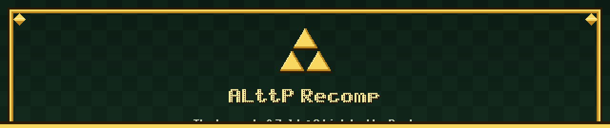
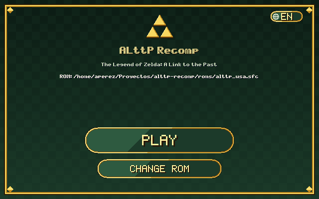
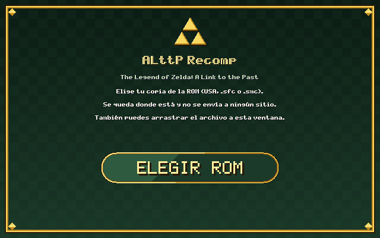
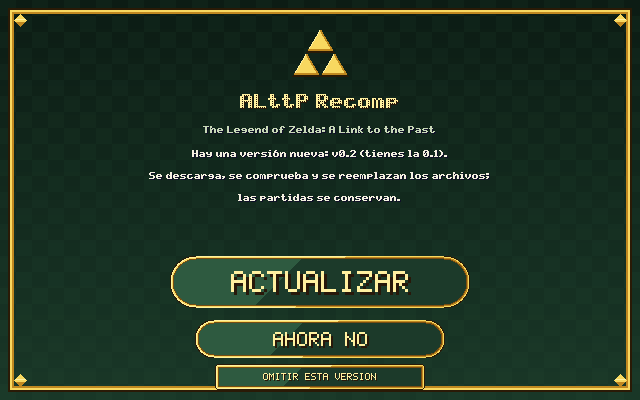
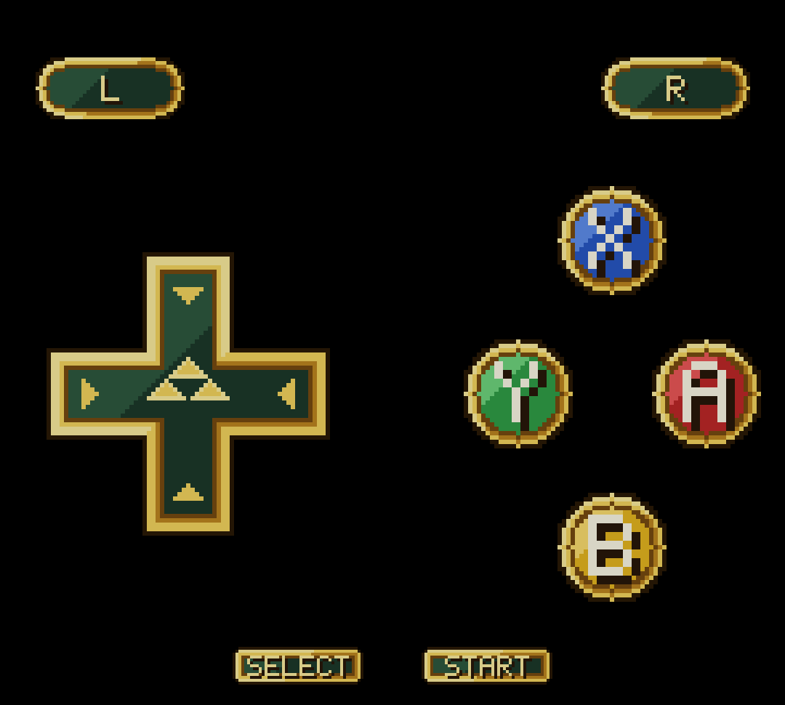

  

<h3 align="center">The Legend of Zelda: A Link to the Past, recompiled to native code</h3>

<b>English</b> · <a href="README.es.md">Español</a> · <a href="https://alekaydevs.github.io/alttp-recomp/">Download page</a>

  
  
  
  
  

This is not an emulator: the cartridge's program is **translated to native code** (with the [`snes-recomp`](https://github.com/AlekayDevs/snes-recomp) engine) and compiled on your machine from **your** copy of the game. The result starts instantly, holds 60 frames per second even on a high-end phone, and allows improvements an emulator can't give: widescreen, Spanish, save states and rewind, and a handful of quality-of-life options.

> **Legal notice.** This repository contains neither the ROM nor any asset of the game (graphics, sound, text, maps), and never will. Everyone must supply their own legally obtained copy (USA, CRC32 `777AAC2F`). Nothing derived from it is distributed or leaves your machine. Independent project, not affiliated with Nintendo.

## Download and play

The easiest way is the **[download page](https://alekaydevs.github.io/alttp-recomp/)**: it detects your system and gives you the right file. You can also take the package from the [latest release](https://github.com/AlekayDevs/alttp-recomp/releases/latest). **Nothing to install, no terminal needed.**

| | Windows | Linux | Android |
|---|---|---|---|
| **File** | `alttp-recomp-…-win64.zip` | `alttp-recomp-…-linux-x86_64.tar.gz` | `ALttP-Recomp-….apk` |
| **1.** | Unzip | Extract | Download and install (allow the source) |
| **2.** | Open `snes-port.exe` | Open `alttp-recomp` | Open the app |
| **3.** | **Choose ROM** and **Play** | **Choose ROM** and **Play** | Pick your ROM and play |
| **Requirements** | Windows 10 or 11 | x86_64, glibc 2.34+ (Ubuntu 22.04, Debian 12 or newer) | Android 10+ (arm64) |

  
  
  

The Windows and Linux launcher: pick your ROM once, then just press <b>Play</b>. On the right, the optional new-version notice. The globe at the top right switches the language (on Linux; on Windows it follows the system language).

The ROM stays where it is: only its path is remembered, and on Android it is copied to the app's private folder. The first time, the game is prepared on your machine (a few seconds on Linux and Android); if something fails, the window tells you.

> It is normal for some antivirus to distrust an unsigned program that compiles code at startup. Everything happens on your machine.

## Features

- **Recompilation, not emulation.** All 4,178 functions of the ROM are translated to C and compiled; no emulation layer.
- **Clean widescreen.** With `wide`, the map edge and the inside of rooms and caves are covered in black instead of repeating the other side of the map.
- **Full Spanish translation.** Messages, file select, name entry and the pause-menu actions, with accents, `ñ`, `¿` and `¡` drawn on the fly with the game's own font. [How it works →](docs/TRADUCCION.md) (in Spanish)
- **Save states and rewind.** **F5** saves, **F7** loads, **F3**/**F4** change slot (up to 9), **F6** opens a picker with all nine slots (thumbnail and date for each) and holding **Backspace** rewinds about 10 seconds.
- **Faster messages.** Hold **R** (or `W` on the keyboard) and text prints one character per frame.
- **Optional quality-of-life improvements** (skip the intro with a key, item switching with L/R, a sword that picks up items and breaks pots, up to 9999 rupees…): [full list](#quality-of-life-improvements).
- **Real Android support.** An APK with touch controls made for the game: the pad with the Triforce (the direction is read by angle, so a thumb slightly off-axis does not give two directions at once), gem-style A/B/X/Y buttons, portrait and landscape layouts, and plates for save states (**SAVE**, **LOAD**, **SLOT** and **REWIND**). The **options menu can be used by touch** too (tabs, rows, tap the left or right half of a value), and the start screen has the same look as the desktop launchers, with an **EN / ES** language button.
- **Launchers for every system.** Windows: a window where you pick your ROM once. Linux: a self-contained native launcher (no gcc needed; it carries its own compiler) with the game's art and an **EN / ES** language button. Android: the app's start screen. All of them show **Play** once your ROM is chosen.
- **Updates from inside the app.** Windows and Linux: the launcher notices a new version and installs it after checking its SHA-256 (**off by default**). Android: the app notices it, downloads the APK, checks its SHA-256 and hands it to Android's installer (**on by default**, switch it off on the start screen). [Details →](#updates)
- **A download page.** [alekaydevs.github.io/alttp-recomp](https://alekaydevs.github.io/alttp-recomp/) picks the right package for your system and always points to the latest release.
- **Tested.** Each improvement, the save states (a real game saved, damaged and loaded back must leave the machine bit for bit the same), the touch controls and the menu have automatic tests that play the game with a script.
- **Privacy.** No telemetry and no accounts. The only possible connection is the version check; your ROM and your saves never leave your device.

  

Touch controls of the Android version (original art).

## Why not just use an emulator?

An emulator is the best choice for playing *any* SNES game with maximum fidelity. This project does something else: it turns **this** game into a native program, and that allows what an emulator can't give with the original ROM.

| | Emulator | ALttP Recomp |
|---|---|---|
| **Gameplay improvements** (item switching with L/R, a sword that picks up items and breaks pots, more bombs, 9999 rupees…) | Need a ROM hack or an IPS patch | Turned on from the menu over your untouched ROM, each with an automatic test |
| **Spanish** | A patch applied to the ROM | Substituted in real time, with accents and `ñ` drawn with the game's own font; the file is re-read while you play |
| **Widescreen** | Usually not, or with per-game tricks | Real extra columns, covered in black where there is no map |
| **Android** | Install an emulator and configure it | An APK with touch controls made for the game |
| **Extensible** | Reverse engineering and patching | An improvement is added by writing C over the already-translated code |
| **Hardware fidelity** | Very high (bsnes, for example) | Lower: the PPU doesn't emulate interlacing, cycle-exact behavior isn't reproduced and the DSP doesn't use the exact table |
| **Games** | All SNES games | Only this one (USA, CRC32 `777AAC2F`) |

What this project does share with emulators: save states and rewind, filters and scanlines, and key and controller remapping from the **F1** menu.

## Roadmap

Things emulators offer and this project doesn't yet. They are not promised and have no date: they are the direction.

- **CRT shader** (phosphor mask, scanline beam, curvature and glow): in progress in the engine.
- **More image and controller settings**, with the comfort of a mature emulator.
- **Achievements** (RetroAchievements) for the game.
- **Online play** (netplay) or shared sessions.
- **Fixes for bugs of the original game**, as options you turn on one by one (every address is checked against the ROM) and more quality-of-life improvements in C, as they get tested.
- **A current Windows package.** The last one is 0.1; the Windows launcher still lacks the language switch and the newest tests, and its automatic update and the rebuild of the engine's `.exe` have not been tried on Windows.

## Quality-of-life improvements

These are game options: turn them on in the **Game** tab of the **F1** menu or with `--game-opt name=value`. Those marked ✔ are on by default; the rest are off.

Music and sound-effect volume are adjusted separately in the menu's **Audio** tab (`music_volume` and `sfx_volume`); the profile tells the engine which sound voices are effects.

| | Option | What it does |
|---|---|---|
| ✔ | `dialog_skip` | Hold **R** during a message and it prints one character per frame. |
| | `language=es` | The game in Spanish (messages, file select, menus). |
| | `wide=N` | Widescreen with the extra columns covered in black where there is no map. |
| | `item_switch_lr=1` | **L**/**R** (`Q`/`W`) pick the previous or next item and put it on Y without opening the menu. |
| | `dash_turn=1` | Changing direction while dashing with the boots turns Link instead of cutting the dash short. |
| | `bird_cancel=1` | On the flute-bird map, **B** cancels the trip and leaves you where you were. |
| | `sword_pickup=1` | The sword swing picks up the floor items it reaches (rupees, hearts, magic, bombs, arrows, keys). |
| | `sword_pots=1` | In dungeons, the sword breaks pots like the hammer. |
| | `more_bombs=1` | Four bombs placed at once instead of two (each still uses one). |
| | `rupees_9999=1` | The wallet holds up to 9999 rupees, with a four-digit counter. |
| | `rupee_fast=1` | The rupee counter reaches the wallet in a couple of seconds (instead of one rupee per frame: 500 rupees take 8 s), going up and down. |
| | `max_yellow=1` | Rupees, bombs and arrows at their cap are drawn in yellow. |
| | `skip_intro=1` | **Start** or **A** during the intro (the logo, the story and the Triforce) jump to file select. |
| | `fix_portal_chime=1` | Fix for an original bug: lifting the rock that covers the magic portal in the Ice Palace didn't play the discovery sound. |
| | `fix_death_count=1` | Fix for an original bug: choosing "Continue" without saving on the game-over screen counted the death anyway. |
| | `fix_medallion_abort=1` | Fix for an original bug: Bombos, Ether and Quake are no longer cancelled if you release the charged sword swing on the same frame you use them. |
| | `fix_magic_refund=1` | Fix for an original bug: the magic refund (when an effect fails) no longer goes past 128. |
| | `fix_somaria_nomagic=1` | Fix for an original bug: using the Cane of Somaria without magic and quickly switching to the mushroom or powder no longer scatters powder without pressing anything. |
| | `fix_moldorm_sound=1` | Fix for an original bug: the giant Moldorm's hit on Link makes a sound (the original loses the sound when computing the pan). |
| | `fix_swamola_bank=1` | Fix for an original bug: the Lanmolas (Swamola) of Misery Mire read their table with the wrong data bank and their segments come out wrong. |
| | `fix_kiki_bomb=1` | Fix for an original bug: the bomb Kiki was carrying isn't left armed when he starts following you. |
| | `fix_bunny_palette=1` | Fix for an original bug: dying as a bunny restores Link's palette during the death animation. |
| | `fix_spell_lock=1` | Fix for an original bug: after casting a medallion and dying, the save menu no longer gets stuck. |
| | `fix_ledge_platform=1` | Fix for an original bug: exiting while hopping a ledge and getting hit on a platform no longer lets you pass under solid layers. |
| | `fix_shield_palette=1` | Fix for an original bug: the shield dropped by a Pikit loads its palette (Link doesn't keep the previous one's colors). |
| | `fix_door_submodule=1` | Fix for an original bug: using a potion at a door no longer changes the submodule mid-frame. |
| | `fix_stair_tags=1` | Fix for an original bug: entering a staircase just as the room tag triggers no longer puts objects in the wrong place. |
| | `fix_skullwoods_door=1` | Fix for an original bug: the Cane of Somaria on a door switch when leaving Skull Woods no longer overwrites the submodule. |
| | `fix_mushroom_warp=1` | Fix for an original bug: the mushroom can't be picked up in the middle of the mirror warp. |
| | `fix_double_absorb=1` | Fix for an original bug: hearts and fairies aren't absorbed twice on the same frame. |
| | `fix_hidden_hookshot=1` | Fix for an original bug: an object hidden under a rock releases the hookshot that was grabbing it. |
| | `fix_camera_twice=1` | Fix for an original bug: the spin attack between bumpers no longer positions the camera twice in one frame. |
| | `fix_bunny_walk=1` | Fix for an original bug: the temporary bunny uses the permanent one's walk animation. |
| | `low_hp_beep=0` | Removes the low-health beep. |

The improvements that touch the game (`skip_intro`, `fix_portal_chime`, `fix_death_count`, `fix_medallion_abort`, `fix_magic_refund`, `fix_somaria_nomagic`, `fix_moldorm_sound`, `fix_swamola_bank`, `fix_kiki_bomb`, `fix_bunny_palette`, `fix_spell_lock`, `fix_ledge_platform`, `fix_shield_palette`, `fix_door_submodule`, `fix_stair_tags`, `fix_skullwoods_door`, `fix_mushroom_warp`, `fix_double_absorb`, `fix_hidden_hookshot`, `fix_camera_twice`, `fix_bunny_walk`, `item_switch_lr`, `dash_turn`, `bird_cancel`, `sword_pickup`, `sword_pots`, `more_bombs`, `rupees_9999`, `rupee_fast`) are tested automatically with games played by a script (`scripts/check.ps1` / `check.sh`).

## Save states and saves

Saves (`.srm`) and states (`.sst`) go to the `saves/` folder next to the program (on Linux, `~/.local/share/alttp-recomp/saves`). States can only be saved during gameplay, not in the intro or on the title screen. Each state has a thumbnail next to it (`.sN.thumb`) that the slot picker shows with the date; states saved with an earlier version appear without a thumbnail until they are saved again. Neither states nor thumbnails are ever published.

## Updates

On Windows and Linux the launcher can notice a new version and install it. It is **off by default**: tick **Check for updates (uses the Internet)** and it will query GitHub at most once a day. If there is a newer version it asks (**Update**, **Not now**, **Skip this version**); if you accept, it downloads the package for your system, checks its SHA-256 against the `SHA256SUMS` of the same release and copies the files over the installation (saves and the ROM are not touched). It only downloads; nothing is sent. On Android the check is **on by default** (switch it off on the start screen) and the notice offers **Download and install**: the app downloads the APK, checks its SHA-256 against the same `SHA256SUMS` and hands it to Android's installer, which asks you to confirm (the first time Android also asks to allow this app to install apps). The new APK has to be signed with the same key, so it installs over the old one. The start screen also has a language button (EN / ES), and the options menu can be used by touch.

## Going further

Most of the documentation is in Spanish.

- [**Translation and text**](docs/TRADUCCION.md): how messages and menus are dumped and translated without touching the ROM.
- [**Development**](docs/DESARROLLO.md): building from source, repository layout, tests, packaging and known limitations.
- [**`snes-recomp` engine**](https://github.com/AlekayDevs/snes-recomp): the recompiler, the PPU, the sound and the runtime.
- [Contributing](CONTRIBUTING.md): never upload the ROM or anything derived from it.

## License

[MIT](LICENSE), only for the code in this repository; it grants no rights over the game. The engine carries its own license ([`LICENSE-engine`](LICENSE-engine)).
